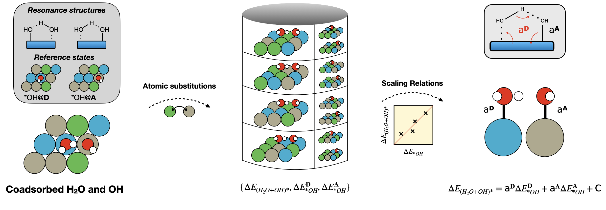

# HiBOI
### Heuristic Bond Order Inference

HiBOI is a Python-based tool for heuristic inference and assignment of chemical bond orders from atomic structures.

The project aims to provide an automated and reproducible approach to bond order inference, combining chemical heuristics with computational analysis.

> **Status:** Under development (pre-release).

## Features

- [ ] Automated bond order inference from atomic structures
- [ ] Heuristic identification of bonding interactions
- [ ] Support for common chemical elements and bonding environments
- [ ] Export of inferred bond orders in standard chemical formats
- [ ] Configurable inference rules and parameters

*Features will be updated as the project develops.*

## Installation

HiBOI is currently under development and is not yet available as a stable package.

Clone the repository:

```bash
git clone <repository-url>
cd hiboi
```

Install the required dependencies:

```bash
pip install -r requirements.txt
```

## Usage

Usage instructions and examples will be added as the implementation develops.

A minimal example of the intended interface:

```python
from hiboi import BondOrderInference

# Initialise the inference procedure
inference = BondOrderInference()

# Infer bond orders from an atomic structure
results = inference.infer(atoms)
```

## Project structure

```text
hiboi/
├── README.md
├── LICENSE
├── requirements.txt
├── src/
│   └── hiboi/
├── tests/
├── examples/
└── docs/
```

## Methodology

HiBOI uses heuristic approaches to infer chemical bond orders from structural and computational information.



Further details on the underlying methodology, assumptions, inference rules and limitations will be documented here.

## Development

Contributions, suggestions and bug reports are welcome.

During development, the project follows a test-driven and version-controlled workflow to facilitate reproducibility and maintainability.

## Citation

If you use HiBOI in scientific work, please cite the associated publication (to be added).

## License

HiBOI is distributed under the [MIT License](LICENSE).

## Acknowledgements

Acknowledgements and references to relevant methods, software and scientific contributions will be added here.
